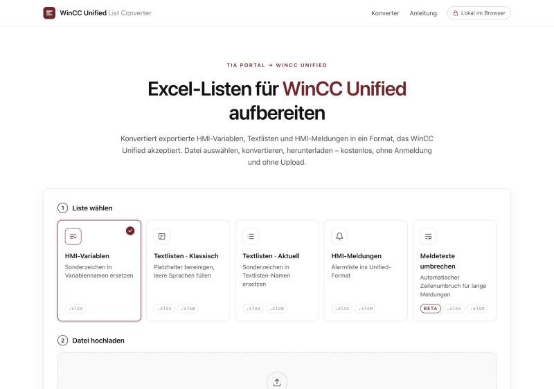

<div align="center">

# WinCC Unified List Converter

**Excel-Exporte aus dem TIA Portal für WinCC Unified aufbereiten – direkt im Browser.**

[](https://paul-rafael.github.io/wincc-unified-list-converter/)
[](#datenschutz)
[](src)

[**Converter öffnen →**](https://paul-rafael.github.io/wincc-unified-list-converter/)



</div>

---

Bei der Migration eines WinCC-Projekts auf Unified Panels müssen HMI-Variablen, Textlisten und HMI-Meldungen angepasst werden: Unified akzeptiert keine Sonderzeichen in Namen, verwendet eine andere FieldInfo-Struktur für Meldungen und bricht lange Meldetexte nicht mehr automatisch um. Der **WinCC Unified List Converter** erledigt diese Arbeit in Sekunden. Datei hineinziehen, konvertieren, herunterladen – ohne Installation, ohne Anmeldung und ohne dass die Datei den Rechner verlässt.

## Funktionen

| | Funktion | Was sie macht | Eingabe | Ergebnis |
|---|---|---|---|---|
| 1 | **HMI-Variablen** | Ersetzt alle Sonderzeichen in Variablennamen durch `_` | `.xlsx` | `HMITagList_MIGUNI.xlsx` |
| 2 | **Textlisten · Klassisch** | Bereinigt Platzhalter (`<No value>`, `<field ref="0" />`) und Tags, füllt leere Sprachvarianten | `.xlsx` `.xlsm` | `<Name>_MIGUNI.xlsx` |
| 3 | **Textlisten · Aktuell** | Ersetzt `# / .` und `[ ]` in den Namen von Textlisten und Einträgen | `.xlsx` `.xlsm` | `<Name>.xlsx` |
| 4 | **HMI-Meldungen** | Erzeugt die Unified-Alarmliste `DiscreteAlarms` (44 Spalten) inkl. neuer FieldInfo | `.xlsx` `.xlsm` | `Unified_HMI-Alarms.xlsx` |
| 5 | **Meldetexte umbrechen** <sup>Beta</sup> | Teilt Meldetexte in Fehlercode und Zeilen à max. 80 Zeichen (`¶`) | `.xlsx` `.xlsm` | gleicher Dateiname |

Eine ausführliche Anleitung zu jeder Funktion ist direkt in die Anwendung integriert.

## Highlights

- **Datenschutz durch Architektur** – Die gesamte Verarbeitung läuft im Browser. Es gibt keinen Server, kein Tracking, keine Cookies und keinen Upload.
- **Formattreu** – Nur die betroffenen Zellen werden geändert. Formatierungen, Spaltenbreiten, weitere Blätter und alle übrigen Inhalte der Arbeitsmappe bleiben unverändert.
- **Regelgetreu** – Die Konvertierungslogik ist eine 1:1-Portierung eines in der Praxis erprobten Excel-/VBA-Werkzeugs, einschließlich seiner Sonderfälle.
- **Nachvollziehbar** – Werte, die Excel möglicherweise anders interpretieren würde (Zahlen, Datumswerte, Formeln), werden mit Zellangabe als Hinweis ausgegeben, statt sie still zu verändern.
- **Getestet** – Automatisierte Tests für jede Regel; die Ergebnisdateien werden in Microsoft Excel ohne Reparaturmeldung geöffnet.
- **Responsiv** – funktioniert auf Desktop, Tablet und Smartphone, im hellen und dunklen Modus.

## Nutzung

1. [Converter öffnen](https://paul-rafael.github.io/wincc-unified-list-converter/)
2. Funktion wählen und die Exportdatei aus dem TIA Portal hineinziehen
3. **Konvertieren** klicken und das Ergebnis herunterladen
4. Hinweise prüfen und die Datei wieder ins Projekt übernehmen

## Entwicklung

Voraussetzung: [Node.js](https://nodejs.org/) 20 oder neuer.

```bash
git clone https://github.com/paul-rafael/wincc-unified-list-converter.git
cd wincc-unified-list-converter
npm install
npm run dev        # Entwicklungsserver auf http://localhost:5173
```

| Befehl | Beschreibung |
|---|---|
| `npm run dev` | Entwicklungsserver mit Live-Reload |
| `npm test` | Unit- und Dateitests (Vitest) |
| `npm run build` | Typprüfung und statischer Build nach `dist/` |
| `npm run preview` | Build lokal ansehen |
| `npm run deploy` | Build auf GitHub Pages veröffentlichen (Branch `gh-pages`) |

### Projektstruktur

```
src/
├── converters/   Die fünf Funktionen – je eine Datei, mit Verweis auf die Originalregel
├── vba/          Nachbildung von VBA-/Excel-Verhalten (Trim, Like, CStr, Texterkennung)
├── xlsx/         XLSX lesen, Zellen formattreu ändern, neue Arbeitsmappen schreiben
├── main.ts       Oberfläche
└── styles.css
tests/
├── unit/         Tests für alle Regeln und Sonderfälle
└── fixtures/     Beispiel-Exportdateien
docs/             Analyse, Regelwerk und bekannte Abweichungen
```

### Technik

- **TypeScript** (strict) und **Vite** – statischer Build ohne Backend
- **JSZip** als einzige Laufzeitabhängigkeit; die Excel-Dateien werden direkt auf XML-Ebene bearbeitet. Gängige Tabellenbibliotheken verwerfen beim Speichern Formatierungen oder Dateibestandteile.
- **Vitest** für automatisierte Tests

## Veröffentlichung

Die Anwendung verwendet relative Pfade und läuft deshalb unter jeder GitHub-Pages-Adresse.

```bash
npm run deploy
```

Einmalig unter **Settings → Pages** als Quelle *Deploy from a branch* → `gh-pages` / `(root)` wählen.

## Dokumentation

- [Analyse & Regelwerk](docs/ANALYSE_UND_PLAN.md) – alle Umwandlungsregeln im Detail
- [Abweichungen & Teststand](docs/ABWEICHUNGEN.md) – bekannte Unterschiede zum Excel-Original

## Datenschutz

Dateien werden ausschließlich lokal im Browser gelesen und erzeugt. Die Seite lädt keine externen Skripte, Schriften oder Tracker.

## Hinweis

Die Ergebnisse sollten vor dem Import ins Projekt stichprobenartig geprüft werden. *Meldetexte umbrechen* befindet sich noch in der Beta-Phase.

WinCC und TIA Portal sind Marken ihrer jeweiligen Inhaber. Dieses Projekt ist ein unabhängiges Werkzeug und steht in keiner Verbindung zu den Markeninhabern.

---

<sub>Entwickelt von **Paul-Rafael Hasan-Man**</sub>
